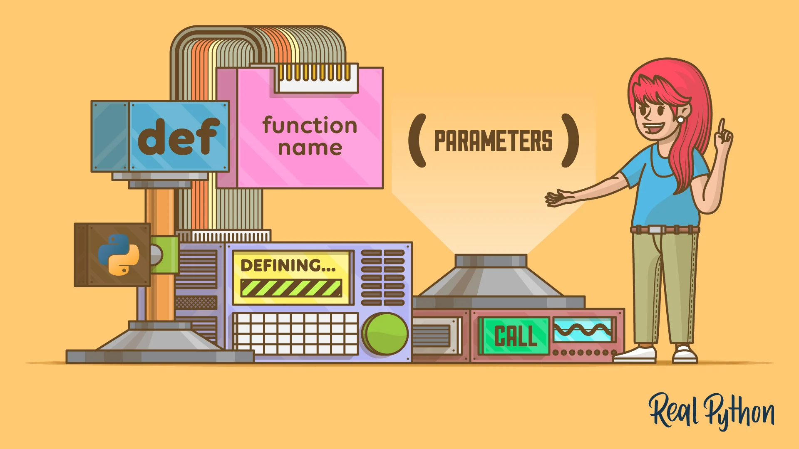
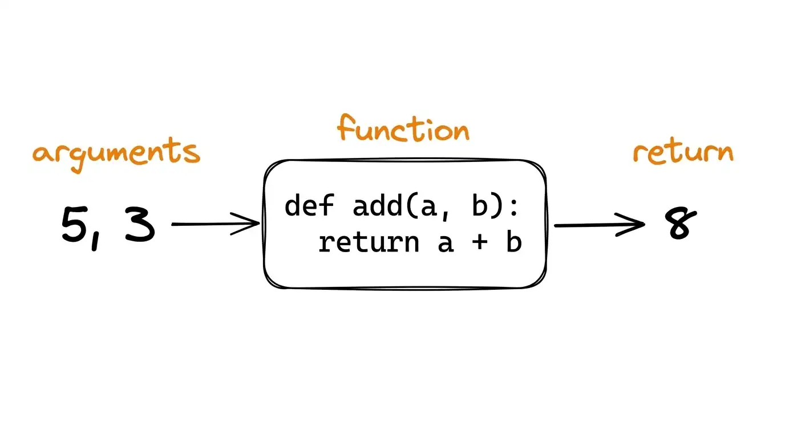

# Modul 10: Fungsi (Functions)

Pada modul sebelumnya kita sudah membahas prinsip **DRY (Don't Repeat Yourself)** menggunakan perulangan (*loop*). Namun, *loop* hanya bisa mengulang kode di satu tempat yang sama berurutan.

Bagaimana jika kita butuh menjalankan sebuah blok kode yang sama di berbagai baris yang berbeda, atau bahkan di file yang berbeda? Di sinilah kita menggunakan **Fungsi (*Function*)**.



Fungsi ibarat sebuah **"mesin"** (atau resep) yang kita buat sendiri. Kita merakitnya sekali, lalu kita bisa memanggil dan menggunakan mesin tersebut berkali-kali kapan pun kita butuhkan hanya dengan memanggil namanya.



---

## 1. Membuat dan Memanggil Fungsi Dasar
Pada Python, fungsi dibuat menggunakan kata kunci `def` (singkatan dari *define*), diikuti dengan nama fungsi, tanda kurung `()`, dan titik dua `:`.

```python
# 1. TAHAP PEMBUATAN (Mendefinisikan fungsi)
>>> def sapa_mahasiswa():
...     print("Halo!")
...     print("Selamat datang di Statistika Bisnis.")
... 

# 2. TAHAP PEMANGGILAN (Menggunakan fungsi)
>>> sapa_mahasiswa()
Halo!
Selamat datang di Statistika Bisnis.

>>> sapa_mahasiswa()  # Bisa dipanggil berkali-kali
Halo!
Selamat datang di Statistika Bisnis.
```

**Soal 1**
Terkadang kita butuh garis pemisah untuk merapikan output. Buatlah sebuah fungsi bernama `cetak_garis()`. Di dalam fungsi tersebut, tuliskan perintah untuk mencetak karakter `"="` sebanyak 40 kali. Panggil fungsi tersebut dua kali untuk membuktikan mesinmu bekerja!

---

## 2. Parameter dan Argumen (Input Fungsi)
Mesin yang bagus tentu bisa menerima bahan baku. Dalam fungsi, "bahan baku" ini disebut **Parameter** (saat dibuat) dan **Argumen** (saat dipanggil). Kita meletakkannya di dalam tanda kurung `()`.

```python
# 'nama' di sini adalah Parameter
>>> def sapa_personal(nama):
...     print(f"Halo, {nama}! Selamat Pagi!")
... 

# "Andi" dan "Budi" di sini adalah Argumen
>>> sapa_personal("Andi")
Halo, Andi! Selamat Pagi.

>>> sapa_personal("Budi")
Halo, Budi! Selamat Pagi.
```

Kita juga bisa memasukkan lebih dari satu parameter, cukup pisahkan dengan koma.

```python
>>> def perkenalan(nama, asal_kota):
...     print(f"Perkenalkan, saya {nama} dari {asal_kota}.")
... 
>>> perkenalan("Ijul", "Surabaya")
Perkenalkan, saya Ijul dari Surabaya.
```

**Soal 2**
Buatlah fungsi bernama `hitung_luas_persegi(sisi)`. Fungsi ini menerima satu parameter yaitu panjang `sisi` (angka). Di dalam fungsi, hitung luas persegi (sisi * sisi) lalu cetak hasilnya dengan kalimat `"Luas persegi adalah: [hasil]"`. Panggil fungsi tersebut dengan memasukkan angka 5, 10, dan 15.

---

## 3. Nilai Kembalian (`return`)
Apa yang membedakan return dengan print jika keduanya sama-sama menampilkan sesuatu ke layar? Perbedaannya adalah:
- `print()` HANYA menampilkan tulisan ke layar terminal. Data itu hilang begitu saja setelah tercetak.
- `return` **mengembalikan/menghasilkan** sebuah nilai secara nyata ke dalam program, sehingga nilai tersebut bisa disimpan ke dalam variabel lain untuk dihitung lagi.

Sebuah fungsi yang baik, di dunia profesional, biasanya menggunakan `return` daripada sekadar `print()`. Saat `return` dieksekusi, fungsi akan langsung berhenti.

```python
# Fungsi ini MENGEMBALIKAN nilai, bukan mencetaknya
>>> def tambah(angka1, angka2):
...     hasil = angka1 + angka2
...     return hasil
... 

# Karena menggunakan return, kita bisa MENYIMPAN hasilnya ke variabel
>>> nilai_tugas = tambah(80, 15)
>>> print(nilai_tugas)
95

# Bisa juga langsung dihitung lagi
>>> total_akhir = tambah(50, 50) / 2
>>> print(total_akhir)
50.0
```

**Soal 3**
Buatlah fungsi `cek_genap(angka)`. Gunakan *if-else* di dalamnya. Jika `angka` habis dibagi 2 (menggunakan modulus `%`), **`return True`**. Jika tidak, **`return False`**. Simpan hasil pemanggilan fungsi `cek_genap(10)` ke dalam variabel `status_angka`, lalu cetak variabel tersebut.

## CASE PERBEDAAN PRINT DAN RETURN:
- **`print()`** itu seperti **Melihat layar TV**. Kamu bisa melihat angkanya di layar, tapi kamu *tidak bisa* mengambil angka tersebut untuk dihitung lagi. Setelah tercetak, nilainya hilang (*None*). Gunakan `print()` hanya jika tujuanmu **cuma ingin menampilkan pesan ke pengguna**.
- **`return`** itu seperti **Koki yang memberikan makanan ke tanganmu**. Kamu bisa menyimpan makanan itu (ke dalam variabel), memotongnya, atau mengolahnya lagi. Gunakan `return` jika tujuan fungsimu adalah **melakukan perhitungan data yang hasilnya akan dipakai lagi nanti**.

Perhatikan perbedaan fatal di bawah ini:

```python
>>> def tambah_print(a, b):
...     print(a + b)
... 
>>> def tambah_return(a, b):
...     return a + b
... 

# Jika kita mencoba menyimpannya ke dalam variabel:
>>> hasil_print = tambah_print(10, 5)
15
>>> print(hasil_print)  # Datanya kosong/hilang!
None

# SEKARANG BANDINGKAN DENGAN RETURN:
>>> hasil_return = tambah_return(10, 5)
# Tidak ada yang tercetak di layar, tapi nilainya LENGKAP TERSIMPAN.

>>> print(hasil_return * 2)  # Bisa kita hitung/olah lagi
30
```
**Notes:** Saat `return` dieksekusi, fungsi akan langsung berhenti. Kode apa pun di bawah `return` (di dalam blok fungsi tersebut) tidak akan pernah dijalankan.


**Soal 3.1**
Buatlah fungsi bernama `hitung_luas_persegi(sisi)`. Fungsi ini menerima satu parameter yaitu panjang `sisi` (angka). Di dalam fungsi, hitung luas persegi (sisi * sisi) lalu cetak hasilnya dengan kalimat `"Luas persegi adalah: [hasil]"`. Panggil fungsi tersebut dengan memasukkan angka 5, 10, dan 15. Buatlah Fungsi lanjutan untuk menghitung rata-rata jumlah luas persegi tersebut.

---

## 4. Parameter Default (Nilai Bawaan)
Terkadang kita ingin sebuah parameter bersifat *opsional* (tidak wajib diisi). Kita bisa memberikannya nilai *default* dengan menggunakan tanda `=` saat membuat fungsi. Jika saat dipanggil parameternya dikosongkan, nilai *default* inilah yang akan dipakai.

```python
# Parameter 'diskon' memiliki nilai default 0
>>> def hitung_bayar(harga, diskon=0):
...     potongan = harga * (diskon / 100)
...     total = harga - potongan
...     return total
... 

# Hanya memasukkan 1 argumen (harga), diskon otomatis 0
>>> print(hitung_bayar(100000))
100000.0

# Memasukkan 2 argumen (harga dan diskon), nilai default akan tertimpa
>>> print(hitung_bayar(100000, 20))
80000.0
```

**Soal 4**
Buatlah fungsi `salam(waktu, nama="Kawan")`. Fungsi ini mencetak `"Selamat [waktu], [nama]!"`. 
Panggil fungsi tersebut pertama kali dengan dua argumen: `"Pagi"` dan `"Andi"`. 
Lalu panggil kedua kali HANYA dengan satu argumen: `"Sore"`. Perhatikan apa yang terjadi!

---

## 5. Studi Kasus Fungsi 
Mari gabungkan pengetahuan kita tentang Parameter, Return, If-Else, dan Logika ke dalam satu fungsi utuh yang sangat berguna!

**Soal 5**
Buatlah sebuah fungsi bernama `konversi_nilai(nilai_angka)`.
Fungsi ini akan menerima satu parameter angka, lalu mengeceknya menggunakan `if-elif-else`:
- Jika nilai $\ge 86$, `return "A"`
- Jika nilai $\ge 76$ dan $< 86$, `return "AB"`
- Jika nilai $\ge 66$ dan $< 76$, `return "B"`
- Jika di bawah itu, `return "C"`

Setelah fungsi dibuat, mintalah input `nilai` (integer) dari pengguna menggunakan `input()`. Masukkan nilai tersebut ke dalam fungsi `konversi_nilai()`, simpan nilai kembaliannya ke dalam variabel `indeks`, lalu cetak `"Nilai huruf Anda adalah: [indeks]"`.